<h2 align="center">Front-end Developer · Shopify Specialist</h2>

  Building, customizing and optimizing Shopify stores — themes, apps, integrations and Shopify Functions.

 

###  About

- Development and maintenance of **Shopify** stores, from new projects to live stores
- **Themes, apps, integrations** and **Shopify Functions**
- Focus on **performance, responsiveness and UX**
- **Git/GitHub** and agile teams for consistent, scalable deliveries

### Stack

  
  

###  Stats

### Contact

